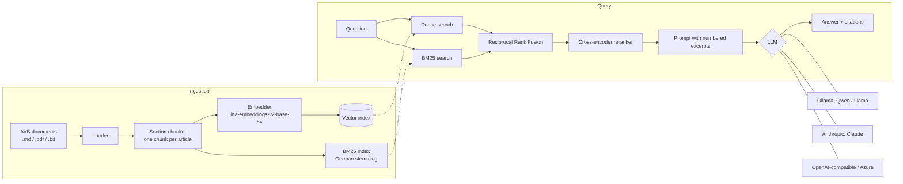

# Versicherungs-RAG

**A retrieval-augmented generation (RAG) assistant for German insurance conditions, with a built-in evaluation harness that compares open-source and commercial LLMs on quality, faithfulness, latency and cost.**

Ask a question in plain German, such as *"Mein Koffer kam 8 Stunden zu spät an. Was wird ersetzt?"*, and get a short answer that cites the exact article it comes from. If the documents don't answer the question, the assistant says so instead of guessing.

 

```
$ vrag ask "Ist ein Marderschaden in der Teilkasko versichert?"

Ja, ein Marderschaden ist in der Teilkasko versichert, jedoch nur bis EUR 1.500 je Schadenfall [1].

  [1] AVB Kasko 2026, Artikel 1 – Teilkasko

(llama3.2-3b, retrieval 3069 ms, generation 21.8 s)
```

## Why this project

Insurance conditions (AVB) are long, legally structured and full of exact numbers, deadlines and exclusions. A wrong answer costs more than no answer. That makes them a good test case for the questions that matter when RAG goes into production:

* **Which model?** Is a small open-source model running on our own hardware good enough, or do we need a cloud API?
* **Which retrieval setup?** Does hybrid search or a reranker actually help *on our documents*?
* **Can we trust it?** Does it cite its sources, and does it decline when the answer isn't in the documents?

This project answers those questions with measurements instead of gut feeling.

## Features

| | |
|---|---|
| **Structure-aware chunking** | Splits by article (`Artikel 5 – Leitungswasserschäden`) instead of fixed windows. Every chunk carries document title and article heading. |
| **Hybrid retrieval** | BM25 with German stemming plus dense vectors (`jina-embeddings-v2-base-de`), merged with Reciprocal Rank Fusion. Optional cross-encoder reranking. |
| **Grounded answers** | German system prompt that forces citations `[n]` and an explicit "no information" answer. Citations are mapped back to the source articles. |
| **Swappable LLMs** | Ollama (local open-source), Anthropic, any OpenAI-compatible endpoint (OpenAI, Azure OpenAI, vLLM), plus a no-LLM extractive baseline. Configure them in [`config/models.yaml`](config/models.yaml). |
| **Evaluation harness** | 41 hand-written questions in four categories, deterministic metrics, optional LLM-as-a-judge, reports as Markdown and JSON. |
| **REST API + web UI** | FastAPI with OpenAPI docs and a `/compare` endpoint that asks several models the same question side by side. |
| **Production basics** | Typed config through env vars, Docker + docker-compose (app + Ollama), GitHub Actions CI, 31 tests that run without model downloads. |

## Architecture



```
src/versicherungs_rag/
├── ingestion/        loaders (MD, PDF with page numbers) and chunking strategies
├── retrieval/        embedder, BM25, vector index, RRF fusion, reranker
├── llm/              provider-independent LLMClient + Ollama/Anthropic/OpenAI/baseline
├── evaluation/       test set, metrics, LLM judge, runner, reports
├── pipeline.py       retrieve → prompt → generate → map citations
├── prompts.py        German system prompt, refusal and citation parsing
├── api.py            FastAPI app (+ static/index.html)
└── cli.py            vrag ingest | ask | models | eval | eval-retrieval | serve
```

## Quick start

Requirements: Python 3.11+ and [Ollama](https://ollama.com) for the local models.

```bash
git clone https://github.com/Sepidehri/versicherungs-rag.git
cd versicherungs-rag
python -m venv .venv && source .venv/bin/activate   # Windows: .venv\Scripts\activate
pip install -e ".[dev]"

ollama pull qwen2.5:3b
ollama pull llama3.2:3b

vrag ingest                 # chunk + embed the documents in data/documents
vrag models                 # which models are ready?
vrag ask "Wie hoch ist der Selbstbehalt in der Vollkasko?"
vrag serve                  # web UI on http://localhost:8000, API docs on /docs
```

To include Claude, set `ANTHROPIC_API_KEY` (see [`.env.example`](.env.example)).

Or with Docker (app + Ollama):

```bash
docker compose up --build
```

### Using your own documents

Put `.md`, `.txt` or `.pdf` files into `data/documents/` and run `vrag ingest`. Article headings (`Artikel 3`, `Art. 3`, `§ 3`) are detected in PDFs too; citations then include the page number.

## Evaluation

### Test set

[`data/eval/testset.jsonl`](data/eval/testset.jsonl) has 41 questions written against the three sample documents:

| Category | # | Example |
|---|---|---|
| `fakt` | 21 | *Wie hoch ist die Versicherungssumme der Privathaftpflicht?* |
| `grenzfall` (edge case / yes-no with conditions) | 13 | *Mein Fahrrad wurde um 23 Uhr vor dem Haus gestohlen … Ist das versichert?* |
| `dokumentübergreifend` (cross-document) | 2 | *Welcher Selbstbehalt gilt in der Reisegepäckversicherung und welcher in der Teilkasko?* |
| `unbeantwortbar` (not in the documents) | 5 | *Wie hoch ist die monatliche Prämie der Haushaltsversicherung?* |

Each answerable question lists its gold source (document + article) and the facts the answer must contain, each with accepted spellings (`"3.000.000"`, `"3 Millionen"`, …).

### Metrics

| Metric | What it measures |
|---|---|
| **Hit rate @k / MRR** | Retrieval: is the right article among the top-k excerpts, and how high? |
| **Accuracy** | Answerable: all expected facts present and not declined. Unanswerable: declined. |
| **Fact recall** | Share of expected facts present (numbers matched exactly, so `50` ≠ `500`). |
| **Citation accuracy** | At least one citation points to the gold article. |
| **Correct / false refusals** | Declines what it should, answers what it can. |
| **Faithfulness** (optional) | LLM-as-a-judge (1–5): is every claim backed by the excerpts? |
| **Latency p50/p95, cost** | Per question; cost from per-token prices in `models.yaml`. |

The deterministic metrics need no LLM, so they are reproducible and cheap to run in CI. The judge is opt-in (`--judge <model>`) because it adds cost and its own error rate.

```bash
vrag eval-retrieval                                   # chunking × retrieval mode, no LLM needed
vrag eval --models baseline-extractive,qwen2.5-3b,llama3.2-3b
vrag eval --models qwen2.5-3b,claude-haiku --judge claude-haiku
```

Every model gets **the same retrieved excerpts** for a question, so the comparison isolates the LLM.

### Results

Hardware: laptop CPU only (Intel i7-12700H, 16 GB RAM, no GPU). Retrieval: hybrid + reranker, top-4. Full reports are in [`results/sample/`](results/sample).

**Retrieval** (36 answerable questions, [report](results/sample/retrieval/retrieval_report.md))

| Configuration | Hit rate @4 | MRR | Latency p50 |
|---|---|---|---|
| Article chunks · hybrid + reranker | **100 %** | **1.00** | 6.7 s |
| Fixed chunks · hybrid + reranker | 100 % | 0.99 | 7.3 s |
| Fixed chunks · hybrid | 100 % | 0.97 | 94 ms |
| Article chunks · hybrid | 100 % | 0.93 | 87 ms |
| Article chunks · dense only | 100 % | 0.90 | 85 ms |
| Article chunks · BM25 only | 92 % | 0.85 | <1 ms |

On a corpus this small (35 chunks) retrieval is almost saturated. The reranker is the only setup that puts the right article first every time, but on CPU it costs about 5 s per query (on a GPU it would be milliseconds). Fixed-size chunks score well partly because a 1,200-character window spans 2–3 articles and gets credit for each of them. The real cost of fixed chunks shows up in the answers, which cite a mixture of articles.

**Generation** (41 questions, identical context for every model)

| Model | Prompt | Accuracy | Fact recall | Citation correct | Correctly declined | Wrongly declined | Latency p50 |
|---|---|---|---|---|---|---|---|
| llama3.2-3b | v2 | **85 %** | 85 % | 75 % | 100 % | 0 % | 27 s |
| qwen2.5-3b | v1 | 73 % | 75 % | 94 % | 80 % | 0 % | 32 s |
| qwen2.5-3b | v2 | 68 % | 74 % | 92 % | 60 % | 19 % | 25 s |
| llama3.2-3b | v1 | 59 % | 64 % | 39 % | 60 % | 0 % | 27 s |
| extractive baseline (no LLM) | – | 56 % | 69 % | 97 % | 0 % | 0 % | 0 s |

What the numbers showed:

1. **Prompt v1 had a bug that only the evaluation revealed.** The rule "start yes/no answers with Ja or Nein" made both small models answer *every* question with a bare `Nein [1].` or `Ja, [1]`, even "How high is the deductible?". Prompt v2 requires full sentences with the concrete values and adds two few-shot examples.
2. **The same prompt change helped one model and hurt the other.** llama3.2 went from 59 % to 85 %. qwen2.5 became overly cautious: it now declines edge-case questions that need one inference step ("Is this covered?" → "No, because …"). There is no single best prompt; it has to be measured per model.
3. **Small models hallucinate when the answer is missing.** With prompt v1, llama invented a hotline number (`0800 1234564`) that appears nowhere in the documents. The explicit "don't invent numbers" rule plus refusal examples fixed this (100 % correct declines in v2).
4. **The baseline is a useful floor.** Extraction already finds most facts (69 %) but can never decline, and it fails on every question that needs reasoning.

Known measurement limits: refusal detection is pattern-based. One qwen v2 answer ("The number is not in the conditions") is a correct decline in its own words that counts as wrong. The optional LLM judge (`--judge`) catches cases like this.

Next experiment: prompt v3 that tells the model explicitly that exclusions and time limits *do* answer "is it covered?" questions, to bring qwen's false refusals back down without losing llama's gains.

## Design decisions

* **Chunk by article, not by character count.** In insurance conditions one article is one unit of meaning. A fixed window cuts an exclusion off from the rule it restricts. The retrieval evaluation compares both.
* **Prepend document title and heading to every chunk.** "Selbstbehalt" appears in all three documents. Without the header, *"Selbstbehalt in der Vollkasko"* would match the household policy's deductible just as well.
* **Hybrid search.** Embeddings capture paraphrases (*"Koffer kam zu spät"* → *"verspätet ausgeliefert"*). BM25 catches rare exact terms (*Marderbiss*, *PIR*). RRF merges the two without having to calibrate their scores against each other.
* **A refusal is a correct answer.** The prompt defines one exact "no information" sentence, and the test set contains unanswerable questions, so a model that always answers something is penalised.
* **A baseline without an LLM.** The extractive baseline sets a floor and shows what the LLM actually adds, mainly refusals and edge-case reasoning.
* **NumPy instead of a vector database.** For a few thousand chunks, exact search takes under a millisecond and there is no infrastructure to run. `VectorIndex` is a small interface, so Qdrant, pgvector or Azure AI Search can replace it when the corpus grows.
* **Providers behind one interface.** `LLMClient.generate()` is the only thing the pipeline knows about, so adding a model is one YAML entry.

## Limitations and next steps

* The documents are **fictional samples**. Real AVBs are longer and messier (tables, footnotes, scanned PDFs).
* 41 questions are enough to spot large differences, not small ones. The next step would be a larger set written with domain experts.
* German compound words (*Reisegepäckversicherung*) are not split for BM25. A decompounder would improve keyword recall.
* No conversation memory: every question stands alone.
* Next: query rewriting for follow-up questions, streaming responses, tracing (Langfuse / OpenTelemetry), deployment to Azure Container Apps.

## Disclaimer

All documents in `data/documents` are invented for this demo ("Beispiel Versicherung AG"). Nothing here is insurance or legal advice.

## License

MIT
